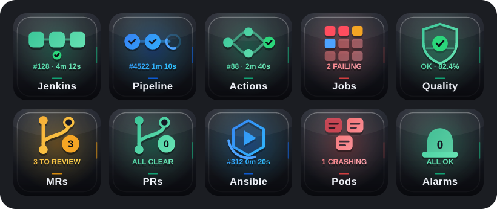

# DevOps Deck

Unofficial Elgato Stream Deck plugin that puts **live CI/CD and operations status** on your keys, on Windows. Version 1.0.0.0.

Ten keys for Jenkins, GitLab, GitHub Actions, pull and merge requests, SonarQube quality gates, Ansible (AWX / Automation Platform), Kubernetes pods and CloudWatch alarms. Each key turns green, blue, amber or red with the real state, shows the build number and time, and animates while something runs. **Tap** opens the page in your browser; **hold for 1 second** starts a run on the keys that can.



## Install in three steps

1. Download **DevOpsDeck-Installer-1.0.0.0.zip** from [Releases](https://github.com/nikhilgs817/streamdeck_devops/releases/latest).
2. Right-click the ZIP, choose **Extract All**, and open the extracted folder.
3. Double-click **Install-DevOpsDeck.cmd**. Wait for the success message; Stream Deck restarts automatically.

No Git, Node.js or build commands are needed. The installer verifies the package, backs up your setup, keeps your layouts and settings, and rolls back a failed update. [Full installation, update and recovery guide](docs/INSTALL.md).

## The keys

| Key | Shows | Tap | Hold 1 s |
|---|---|---|---|
| **Jenkins Job** | Last build: passed, failed, unstable or running (with progress) | Opens the build | Starts a build (with parameters if set) |
| **Jenkins Health** | How many jobs in a view or folder are failing, unstable or running | Opens the view | — |
| **GitLab Pipeline** | Latest pipeline of a project or branch | Opens the pipeline | Runs a new pipeline on the branch |
| **GitHub Actions** | Latest run of a repository or workflow | Opens the run | Runs the workflow (`workflow_dispatch`) |
| **Merge Requests** | GitLab MRs waiting for your review, assigned to you or opened by you | Opens the list | — |
| **Pull Requests** | GitHub PRs waiting for your review, assigned to you or opened by you | Opens the list | — |
| **Quality Gate** | SonarQube / SonarCloud gate and coverage | Opens the project | — |
| **Ansible Job** | Last run of an AWX or Automation Platform job template | Opens the job | Launches the template |
| **Kubernetes Pods** | Ready pods in a namespace; red when a pod crash-loops or can't pull its image | Refreshes | — |
| **CloudWatch Alarms** | Alarms firing in one AWS region | Opens the alarms page | — |

The **DevOps** layout puts all ten on a 15-key deck. On other decks, drag any key from the action list.

**Hold to run** can be switched off per key. While you hold, a ring fills for one second; let go early and nothing starts. A tap never starts anything.

GitHub and GitLab keys work with github.com and gitlab.com and with your own **GitHub Enterprise Server** or **self-managed GitLab**. Ansible works with AWX and with Automation Platform 2.5 (it finds the newer API by itself).

## Setting up a key

Drag a key onto the deck, then paste the page's address from your browser into its settings: the Jenkins job, GitLab project, GitHub repository (`owner/repo` works too), SonarQube project dashboard or AWX template. The key reads every 60 seconds by default (15 s minimum), and every 10 seconds while something runs.

**Tokens.** Private servers need an API token. Each key's settings say where to create it and which scope it needs (read-only is enough except to start runs). Paste it in the **Token** field and press **Save**:

- It is encrypted with Windows (DPAPI) for your Windows account and bound to that one server. Another Windows user, or a copied settings file, can't read it.
- It is never stored in the key's settings, in exported profiles or in logs.
- It is only ever sent to the server you configured, over the address you typed, and the plugin never follows a redirect to another site.
- Keys for the same server share one token, so you paste it once. **Remove** deletes it.

**Kubernetes and CloudWatch** use your own `kubectl` and `aws` command-line tools and their existing sign-in (kubeconfig, AWS profiles or SSO). No token is stored by the plugin. Install the tool and sign in once in a terminal; the key then shows its status.

**Company certificates.** Servers signed by your company's own certificate authority work when Windows trusts that certificate (the plugin reads Windows' trusted roots). **Self-signed OK** is there only for a lab server without a proper certificate.

## What the key tells you

| Key shows | Means |
|---|---|
| Green with ✓ | Passed / all clear |
| Blue, animated | Running, with progress or elapsed time |
| Amber | Unstable, or something waits for you |
| Red with ✕ | Failed, firing or crash-looping |
| SET UP | The key has no address yet; open its settings |
| ADD TOKEN / CHECK TOKEN | No token saved, or the server refused it |
| NOT FOUND | The address is wrong, or the job / project doesn't exist |
| OFFLINE / TIMED OUT | The server or tool didn't answer; the key retries, waiting longer each time (up to 15 minutes) |
| CERTIFICATE | Windows doesn't trust the server's certificate |
| INSTALL KUBECTL / INSTALL AWS CLI | The command-line tool isn't installed |
| SIGN IN | kubectl or the AWS CLI needs you to sign in again (for example, an expired SSO session) |

## Appearance


**Glass** is the default: frosted dark keys whose colour follows the status, a soft rim light and an animated icon. Pick another look for one key, or press **Use this look on all keys** in any key's settings. The looks are the same as in Windows Toolkit: Glass, Vivid, Neon, Pro and Mono, plus your own colours. When Windows' "Animation effects" is off, keys stay still.

## Privacy and safety

DevOps Deck only reads status, except when you hold a key with **Hold to run** on. It talks only to the servers you configure, sends nothing anywhere else, has no telemetry and keeps no history. Addresses must be `http` or `https`; anything else is refused before it reaches your browser.

## Build from source

```
npm ci
npm run build      # generate art and manifest, bundle the plugin
npm test           # simulated Stream Deck + mock Jenkins, GitLab, GitHub, SonarQube and AWX servers
npm run validate   # Elgato's plugin validator
npm run pack && npm run build:installer
```

The tests run the real plugin against a fake Stream Deck and local mock servers, with fake `kubectl` and `aws` programs. They don't need Windows, a deck or any real account.

Not affiliated with Elgato, Jenkins, GitLab, GitHub, SonarSource, Red Hat, the CNCF or Amazon. Their names are used only to describe compatibility.

## License

[MIT](LICENSE)
