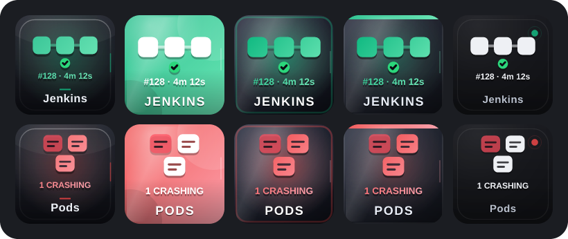

# DevOps Deck

Unofficial Elgato Stream Deck plugin that puts **live CI/CD and operations status** on your keys, on Windows. Version 1.0.0.0.

Ten keys for Jenkins, GitLab, GitHub Actions, pull and merge requests, SonarQube quality gates, Ansible (AWX / Automation Platform), Kubernetes pods and CloudWatch alarms. Each key turns green, blue, amber or red with the real state, shows the build number and time, and animates while something runs. **Tap** opens the page in your browser; **hold for 1 second** starts a run on the keys that can.


## Install in three steps

1. Download **DevOpsDeck-Installer-1.0.0.0.zip** from [Releases](https://github.com/nikhilgs817/streamdeck_devops/releases/latest).
2. Right-click the ZIP, choose **Extract All**, and open the extracted folder.
3. Double-click **Install-DevOpsDeck.cmd**. Wait for the success message; Stream Deck restarts automatically.

No Git, Node.js or build commands are needed. The installer verifies the package, backs up your setup, keeps your layouts and settings, and rolls back a failed update. [Full installation, update and recovery guide](docs/INSTALL.md).

## The keys

| Key | Shows | Tap | Hold 1 s |
|---|---|---|---|
| **Jenkins Job** | Last build: passed, failed, unstable or running (with progress) | Opens the build | Starts a build (with parameters if set) |
| **Jenkins Health** | How many jobs in a view or folder are failing, unstable or running | Opens the view | — |
| **GitLab Pipeline** | Latest pipeline of a project or branch | Opens the pipeline | Runs a new pipeline on the branch |
| **GitHub Actions** | Latest run of a repository or workflow | Opens the run | Runs the workflow (`workflow_dispatch`) |
| **Merge Requests** | GitLab MRs waiting for your review, assigned to you or opened by you | Opens the list | — |
| **Pull Requests** | GitHub PRs waiting for your review, assigned to you or opened by you | Opens the list | — |
| **Quality Gate** | SonarQube / SonarCloud gate and coverage | Opens the project | — |
| **Ansible Job** | Last run of an AWX or Automation Platform job template | Opens the job | Launches the template |
| **Kubernetes Pods** | Ready pods in a namespace; red when a pod crash-loops or can't pull its image | Refreshes | — |
| **CloudWatch Alarms** | Alarms firing in one AWS region | Opens the alarms page | — |

The **DevOps** layout puts all ten on a 15-key deck. On other decks, drag any key from the action list.

**Hold to run** can be switched off per key. While you hold, a ring fills for one second; let go early and nothing starts. A tap never starts anything.

GitHub and GitLab keys work with github.com and gitlab.com and with your own **GitHub Enterprise Server** or **self-managed GitLab**. Ansible works with AWX and with Automation Platform 2.5 (it finds the newer API by itself).

## Setting up a key

Drag a key onto the deck, then paste the page's address from your browser into its settings: the Jenkins job, GitLab project, GitHub repository (`owner/repo` works too), SonarQube project dashboard or AWX template. The key reads every 60 seconds by default (15 s minimum), and every 10 seconds while something runs.

**Tokens.** Private servers need an API token. Each key's settings say where to create it and which scope it needs (read-only is enough except to start runs). Paste it in the **Token** field and press **Save**:

- It is encrypted with Windows (DPAPI) for your Windows account and bound to that one server. Another Windows user, or a copied settings file, can't read it.
- It is never stored in the key's settings, in exported profiles or in logs.
- It is only ever sent to the server you configured, over the address you typed, and the plugin never follows a redirect to another site.
- Keys for the same server share one token, so you paste it once. **Clear** deletes it.

**Kubernetes and CloudWatch** use your own `kubectl` and `aws` command-line tools and their existing sign-in (kubeconfig, AWS profiles or SSO). No token is stored by the plugin. Install the tool and sign in once in a terminal; the key then shows its status.

**Company certificates.** Servers signed by your company's own certificate authority work when Windows trusts that certificate (the plugin reads Windows' trusted roots). **Self-signed OK** is there only for a lab server without a proper certificate.

## Key settings

Every key also has **Check every (s)** (60 by default, 15 at least) and the **Look** settings below. Keys that talk to your own servers have **Self-signed OK** (leave it off unless the server uses its own certificate that Windows doesn't trust).

| Key | Settings | Token (where to create it, and the scope) |
|---|---|---|
| **Jenkins Job** | Job page, User ID, Parameters (optional), Hold to start a build | Jenkins › your name › Security › API Token. Needed to start builds and for private jobs |
| **Jenkins Health** | View page (a view, a folder or the Jenkins home page), User ID | Same Jenkins API token; only for a private view |
| **GitLab Pipeline** | Project page, Branch, Hold to run a pipeline | GitLab › Preferences › Access tokens: `read_api` to read, `api` to run pipelines. Needed for private projects |
| **GitHub Actions** | Repository, Workflow file (needed to run it from the key), Branch, Hold to run the workflow | GitHub › Settings › Developer settings › Fine-grained token: Actions read (write to run). Needed for private repos and to run workflows |
| **Merge Requests** | GitLab server (gitlab.com by default), Count: waiting for my review, assigned to me or opened by me | GitLab access token with `read_api`. Required |
| **Pull Requests** | GitHub server (change only for GitHub Enterprise Server), Count: waiting for my review, assigned to me or opened by me | Fine-grained token with Pull requests read. Required |
| **Quality Gate** | Project page (or server address plus Project key), Branch | SonarQube › My Account › Security › Generate token. Needed for private projects |
| **Ansible Job** | Template page, Hold to launch the template | AWX › your user › Tokens › Add, scope Write to launch. Required |
| **Kubernetes Pods** | Namespace (`*` for every namespace), Context | None: uses your own `kubectl` sign-in |
| **CloudWatch Alarms** | Region (us-east-1 by default), AWS profile | None: uses your own `aws` CLI sign-in |

## What the key tells you

| Key shows | Means |
|---|---|
| Green with ✓ | Passed / all clear |
| Blue, animated | Running, with progress or elapsed time |
| Amber | Unstable, or something waits for you |
| Red with ✕ | Failed, firing or crash-looping |
| SET UP | The key has no address yet; open its settings |
| ADD TOKEN / CHECK TOKEN | No token saved, or the server refused it |
| NOT FOUND | The address is wrong, or the job / project doesn't exist |
| OFFLINE / TIMED OUT | The server or tool didn't answer; the key retries, waiting longer each time (up to 15 minutes) |
| CERTIFICATE | Windows doesn't trust the server's certificate |
| INSTALL KUBECTL / INSTALL AWS CLI | The command-line tool isn't installed |
| SIGN IN | kubectl or the AWS CLI needs you to sign in again (for example, an expired SSO session) |

## Appearance



**Glass** is the default: frosted dark keys whose colour follows the status, a soft rim light and an animated icon. The design is the same as [Windows Toolkit](https://github.com/nikhilgs817/windows_toolkit)'s. Select a key and open **Look**:

| Setting | Choices |
|---|---|
| **Style** | Glass (default), Vivid, Neon, Mono or Pro |
| **Label** | Your own text (up to 18 letters, fitted to the key), Auto case / Title Case / UPPER CASE, or **Hide** |
| **Picture** | **Use my own picture…** (PNG, JPEG, GIF, SVG, WebP or BMP). **Remove picture** goes back to the drawn icon |
| **Animation** | Full, Glow only, Icon only or Still, at Slow, Calm (default), Normal or Fast |
| **Glow** | Subtle, Normal or Bold, plus **Ripple when pressed** |
| **Colour** | Leave it unset and the status colours the key (green, blue, amber, red). Picking one of the 42 themes, or two colours of your own with **Use these colours**, keeps that colour whatever the status. **Back to theme** removes your own colours |
| **Icon** | Swap the drawing for any of 90+ icons |

**Use this look on all keys** copies the style, animation, glow, label case and ripple to every DevOps Deck key. Colours, icons and labels stay as they are. **Reset look** (under the preview) returns a key to the defaults. Keys stay still while Windows **Animation effects** is off, unless you untick **Keep keys still when Windows animations are off**.

## Troubleshooting

- **The key shows SET UP.** Open its settings and paste the page address from your browser.
- **ADD TOKEN / CHECK TOKEN.** Paste a token in **Token** and press **Save**. CHECK TOKEN means the server refused it: it expired, was revoked or lacks the scope in [Key settings](#key-settings). Create a new one and save it again; keys on the same server pick it up.
- **Holding the key doesn't start anything.** Check **Hold to …** is ticked and the token has write scope (Jenkins API token, GitLab `api`, GitHub Actions write, AWX Write). GitHub Actions also needs the **Workflow file** and a `workflow_dispatch` trigger in that workflow.
- **CERTIFICATE.** Windows doesn't trust the server's certificate. Ask IT to install your company's root certificate in Windows, or, for a lab server only, tick **Self-signed OK**.
- **OFFLINE / TIMED OUT.** The server or tool didn't answer (VPN off, server down). The key retries by itself, waiting longer each time (up to 15 minutes). Press it to open the page and check.
- **INSTALL KUBECTL / INSTALL AWS CLI / SIGN IN.** Install the tool, then sign in once in a terminal (for example `aws sso login`, or check `kubectl get pods` works). The key picks it up on its next check.
- **Wrong numbers on Merge Requests / Pull Requests.** Check **Count** and that the token belongs to you; the counts are for the token's user.
- **A key moved to another PC or Windows user shows ADD TOKEN.** That's on purpose: tokens are encrypted for one Windows account. Paste the token again.
- **Logs** are in `%APPDATA%\Elgato\StreamDeck\Plugins\com.windowstoolkit.devops.sdPlugin\logs`; tokens never appear in them. Installer problems are covered in the [installation guide](docs/INSTALL.md).

## Privacy and safety

DevOps Deck only reads status, except when you hold a key with **Hold to run** on. It talks only to the servers you configure, sends nothing anywhere else, has no telemetry and keeps no history. Addresses must be `http` or `https`; anything else is refused before it reaches your browser.

## Build from source

```
npm ci
npm run build      # generate art and manifest, bundle the plugin
npm test           # simulated Stream Deck + mock Jenkins, GitLab, GitHub, SonarQube and AWX servers
npm run validate   # Elgato's plugin validator
npm run pack && npm run build:installer
```

The tests run the real plugin against a fake Stream Deck and local mock servers, with fake `kubectl` and `aws` programs. They don't need Windows, a deck or any real account.

Not affiliated with Elgato, Jenkins, GitLab, GitHub, SonarSource, Red Hat, the CNCF or Amazon. Their names are used only to describe compatibility.

## License

[MIT](LICENSE)
